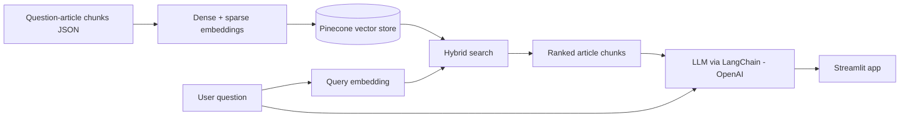

# PathoRAG: Retrieval-Augmented Generation with LLMs for Pathology

Advanced internship project at **Computational Pathology Heidelberg (CPH)** and the **Mannheim Institute for Intelligent Systems in Medicine (MIiSM)**, University of Heidelberg.

PathoRAG is a Retrieval-Augmented Generation (RAG) system that answers pathology questions using a curated pathology corpus instead of relying only on an LLM's built-in knowledge. Every answer is grounded in retrieved article chunks, so you can see where the information comes from, and the system declines to answer out-of-domain questions.

## Motivation

General-purpose LLMs often lack specialised, up-to-date knowledge, can hallucinate, and are largely black boxes. A RAG system over a domain corpus gives more specific answers and makes the source of each answer traceable.

## Key results

| Metric (13 articles, 102 questions) | Value |
|---|---|
| Accuracy | ~80 % |
| Mean precision | 0.8295 |
| Mean recall | 0.8039 |
| Mean F1-score | 0.8165 |

These are preliminary results. The system has not yet been compared against other RAG systems or a plain LLM.

## Architecture



**Phase 1: data encoding and storage**
- Articles are split with a *smart-chunking* approach that keeps sections and paragraphs together.
- Chunks are embedded with two models: dense (`msmarco-bert-base-dot-v5`) and sparse (`naver/splade-cocondenser-ensembledistil`).
- Embeddings and article text are stored in Pinecone (dot-product metric).

**Phase 2: query processing and answer generation**
- The query is embedded with the same models.
- Hybrid search (dense + sparse) retrieves the most relevant chunks and ranks them in Pinecone.
- The chunks, the question and a prompt template go to an OpenAI LLM through LangChain, which generates the answer.
- A Streamlit app provides the user interface.

## Datasets

- **Question-article pairs (used for evaluation):** a pathology quiz mined from [simplemed.co.uk](https://simplemed.co.uk), with 13 articles, 102 questions, ~15k article words and ~3k question words. Questions that need their multiple-choice options were completed with the answer options.
- **Pathology PDF textbooks (experimental):** text extracted with PyMuPDF, chunked and stored as JSON. This pipeline is prepared but was **not** used in the evaluation.
- **Auto-generated questions (experimental):** questions generated from article chunks with `gpt-3.5-turbo` through LangChain, for further testing.

The test dataset will be published on [HeiData](https://heidata.uni-heidelberg.de/) once the consent of simplemed is obtained.

## Results

The retriever was evaluated as a classification task: each question must be matched to the article it belongs to.

### Per-article metrics

| Article | Precision | Recall | F1 |
|---|---|---|---|
| Acute-Inflammation | 0.78 | 0.82 | 0.80 |
| Atherosclerosis | 0.82 | 0.82 | 0.82 |
| Basics-of-pathology | 0.85 | 0.98 | 0.91 |
| Behaviour-of-neoplasms | 0.65 | 0.81 | 0.72 |
| Cellular-adaptations | 0.55 | 0.50 | 0.52 |
| Chronic-inflammation | 0.82 | 0.65 | 0.73 |
| Epithelium-skin-and-exocrine-glands | 0.96 | 0.98 | 0.97 |
| Haemostasis-and-clotting | 0.96 | 0.79 | 0.87 |
| Introduction-to-neoplasia | 0.62 | 0.79 | 0.70 |
| Lymphatic-system | 0.80 | 0.85 | 0.82 |
| Pathogenesis-of-neoplasms | 1.00 | 0.40 | 0.57 |
| Regeneration-and-repair-of-tissues | 1.00 | 0.91 | 0.95 |
| Thrombosis-and-embolism | 0.60 | 0.81 | 0.69 |
| **Mean** | **0.8295** | **0.8039** | **0.8165** |

Epithelium-skin-and-exocrine-glands scores highest. Cellular-adaptations scores lowest. Precision is generally high, while recall varies more across topics.

### Precision


### Recall


### F1-score


### Confusion matrix


Most predictions lie on the diagonal. The off-diagonal entries are the misclassified questions.

### Demo


<!-- TODO: replace Results/demo.png with the actual demo file name in the Results folder -->

Example behaviour:

| Question | Behaviour |
|---|---|
| What are the main lymphoid organs? | Grounded answer from the *Lymphatic system* article |
| What is metaplasia? | Grounded answer; retrieved chunk matches the generated text |
| Are platelets cell fragments involved in blood clotting? | Grounded answer, quoting the retrieved chunk |
| What is photosynthesis? | "I don't know." (out-of-domain, no hallucination) |

## Project structure

```
patho-RAG/
├── code/          # PathoRAG implementation, evaluation, Streamlit app, notebooks
├── Results/       # Metric plots (precision, recall, F1), confusion matrix, demo
├── SPADE/         # TODO: describe contents
├── .gitignore
├── LICENSE
└── README.md
```
<!-- TODO: list the key files in code/ (PathoRAG class, ClassificationTest class,
     Streamlit app, Generating_QA_for_testing.ipynb) -->

## Requirements

### Software dependencies

- Python 3.x
- [LangChain](https://api.python.langchain.com/en/stable/langchain_api_reference.html)
- [Pinecone](https://docs.pinecone.io) client and an account
- `sentence-transformers` and `transformers` (dense and SPLADE sparse embeddings)
- OpenAI API access
- Streamlit
- PyMuPDF (only for the PDF textbook pipeline)

### API keys

Set your own keys before running (OpenAI and Pinecone are paid or account-based services):

```bash
export OPENAI_API_KEY="..."
export PINECONE_API_KEY="..."
```

### Supported operating systems

macOS, Linux, Windows (developed and tested on: TODO).

## Installation

```bash
git clone https://github.com/AnuR1234/patho-RAG.git
cd patho-RAG
conda create -n pathorag python=3.10
conda activate pathorag
pip install -r requirements.txt
```
<!-- TODO: confirm the requirements file location and Python version -->

## Usage

1. Build the index: embed the article chunks and upload them to Pinecone.
2. Run the Streamlit app:

```bash
streamlit run <path-to-streamlit-app>.py
```
<!-- TODO: fill in the real script names from code/ -->

3. To reproduce the evaluation, run the `ClassificationTest` class on the question-article dataset. It reports accuracy, precision, recall, F1-score and the confusion matrix.

## Limitations and future work

- Results are preliminary and not yet compared with other systems or a bare LLM.
- The PDF textbook corpus is prepared but not part of the evaluation.
- Ongoing costs of OpenAI and Pinecone, and chunking and embedding quality, strongly affect performance.

Planned improvements:
- **Query/document alignment:** query rewriting (Query2Doc, HyDE) and embedding transformation.
- **Retriever/LLM alignment:** fine-tuning retrievers (REPLUG, UPRISE), post-retrieval reranking and compression, fine-tuning the LLM for RAG.
- **More sources:** textbooks (PDFs), scanned documents and other pathology corpora.

## References

1. P. Lewis, E. Perez, A. Piktus, F. Petroni, V. Karpukhin, N. Goyal, H. Küttler, M. Lewis, W.-t. Yih, T. Rocktäschel et al., "Retrieval-augmented generation for knowledge-intensive NLP tasks," *Advances in Neural Information Processing Systems*, vol. 33, pp. 9459–9474, 2020.
2. M. Silva, "Retrieval augmented generation: Keeping LLMs relevant and current," Stack Overflow Blog, 18 Oct 2023. https://stackoverflow.blog/2023/10/18/retrieval-augmented-generation-keeping-llms-relevant-and-current/
3. T. Shao, Y. Guo, H. Chen, and Z. Hao, "Transformer-based neural network for answer selection in question answering," *IEEE Access*, vol. 7, pp. 26146–26156, 2019.
4. N. Sadri, "Evaluating dense passage retrieval using transformers," arXiv:2208.06959, 2022.
5. T. Formal, C. Lassance, B. Piwowarski, and S. Clinchant, "SPLADE v2: Sparse lexical and expansion model for information retrieval," arXiv:2109.10086, 2021.
6. A. Reddy, "patho-rag," https://github.com/cpheidelberg/patho-RAG/tree/main/code, 2023.
7. L. Wang, N. Yang, and F. Wei, "Query2doc: Query expansion with large language models," arXiv:2303.07678, 2023.
8. P. Zhao, H. Zhang, Q. Yu, Z. Wang, Y. Geng, F. Fu, L. Yang, W. Zhang, and B. Cui, "Retrieval-augmented generation for AI-generated content: A survey," arXiv:2402.19473, 2024.
9. W. Shi, S. Min, M. Yasunaga, M. Seo, R. James, M. Lewis, L. Zettlemoyer, and W.-t. Yih, "REPLUG: Retrieval-augmented black-box language models," arXiv:2301.12652, 2023.
10. H. Yokota, T. Kobayashi, T. Muraki, and S. Naoi, "UPRISE: Unified presentation slide retrieval by impression search engine," *IEICE Transactions on Information and Systems*, vol. 87, no. 2, pp. 397–406, 2004.

## Authors and contact

**Author:** Anu Reddy
**Mentors:** Jürgen Hesser , Maximilian Legnar, Dr. Cleo-Aron Weis

## Contributing

Contributions are welcome. Fork the repository, make your changes, and open a pull request. Bugs and suggestions can be logged as issues.

## License

Copyright (c) 2023. This code was developed as part of the "Computational Pathology Heidelberg (CPH)" project and is released under the **BSD Simplified License**. See the `LICENSE` file for details and the disclaimer of all warranties.
